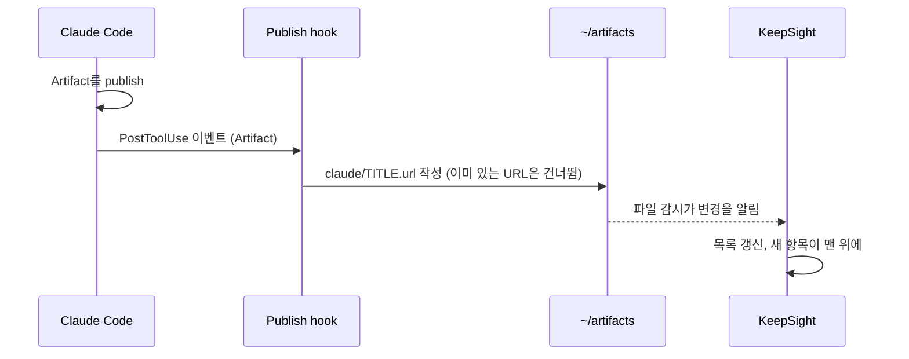
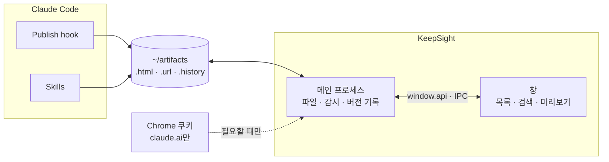

<p align="center">
  
</p>

<p align="center">
  <a href="README.md">English</a> · <b>한국어</b>
</p>

<p align="center">
  <a href="https://github.com/polyglot-k/keepsight/actions/workflows/ci.yml"></a>
  
  
  
  <a href="LICENSE"></a>
</p>

<p align="center">
  <b>Claude로 만든 페이지는 전부 모아 두고, 지금 보는 페이지는 늘 눈앞에.</b><br>
  HTML 파일과 claude.ai Artifact를 로컬에서 관리하는 macOS 앱입니다. 모든 창 위에 떠 있는 집중용 창도 함께 들어 있습니다.
</p>

<p align="center">
  
</p>

## 어떤 앱인가요

KeepSight는 Claude와 일하다 보면 쌓이는 HTML 문서를 위한 macOS 앱입니다. 장애 타임라인, 대시보드, 공부 정리, 설계 리뷰, claude.ai에 publish한 Artifact 같은 문서가 대상입니다.

- **한 폴더에 모읍니다.** 모든 문서는 `~/artifacts`에 들어가고, 하위 폴더가 곧 분류입니다. 데이터베이스도, 가져오기 단계도 없습니다.
- **다시 찾아 줍니다.** 제목과 태그는 물론 페이지 본문까지 검색합니다. ⌘K 팔레트는 다른 앱을 쓰는 중에도 열립니다.
- **잃어버리지 않게 지킵니다.** 저장할 때마다 버전이 자동으로 남아서, 두 버전을 비교하고 원하는 버전으로 되돌릴 수 있습니다.
- **Claude Code와 이어집니다.** Artifact를 publish하면 hook이 북마크를 만들어 줍니다. "keepsight에 저장해"처럼 말로 부탁하면 skill이 HTML을 저장하고 앱을 엽니다.

## 만든 이유

저는 백엔드 개발자입니다. 몇 달 사이에 무언가를 설명할 때 Claude를 쓰는 게 기본이 됐습니다. 조사를 하면 HTML 타임라인이 나왔고, Kafka를 물어보면 대시보드가, 공부를 하면 치트시트가 나왔습니다. 좋은 문서였는데 자꾸 잃어버렸습니다.

어떤 건 claude.ai Artifact라서 지난 대화 속에 묻혔습니다. 어떤 건 Claude Code가 그때 열려 있던 저장소에 써 둔 로컬 파일이었습니다. 지난달에 만든 인덱스 치트시트 하나를 찾으려면 대화 기록을 거슬러 올라가거나 홈 폴더 전체에 `find`를 돌려야 했습니다. Claude가 페이지를 다시 쓰면 이전 버전은 사라졌습니다.

자기만의 형식을 강요하는 새 노트 앱은 원하지 않았습니다. 파일은 제 폴더에 평범한 HTML로 그대로 두고, 그 위에 빠른 창 하나를 얹고 싶었습니다. 목록, 검색창, 미리보기, 버전 기록이 있는 창입니다. 그래서 그걸 만들었고, Claude Code가 알아서 채워 넣게 했습니다.

## 기능

<table>
  <tr>
    <td width="50%"></td>
    <td width="50%"></td>
  </tr>
  <tr>
    <td><b>어디서든 빠른 열기.</b> 앱 안에서는 <kbd>⌘K</kbd>, 다른 앱에서는 <kbd>⌥⌘K</kbd>를 누르면 됩니다. 제목, 폴더, 태그를 몇 글자만 입력해도 찾고, 최근에 연 항목이 위에 옵니다.</td>
    <td><b>버전 기록.</b> HTML 파일이 바뀔 때마다 이전 내용이 남습니다. 버전을 누르면 지금 내용 옆에 나란히 열리고, 클릭 한 번으로 되돌립니다. 되돌리기 직전 내용도 버전으로 남습니다.</td>
  </tr>
  <tr>
    <td></td>
    <td></td>
  </tr>
  <tr>
    <td><b>본문 검색.</b> 검색어가 제목이나 태그에 없으면 페이지 안까지 찾고, 걸린 부분을 앞뒤 문맥과 함께 보여 줍니다.</td>
    <td><b>분할 미리보기.</b> 미리보기를 최대 네 칸까지 나란히 띄웁니다. 칸마다 확대 비율을 따로 둘 수 있고, 경계를 끌어 크기를 조절합니다.</td>
  </tr>
  <tr>
    <td></td>
    <td></td>
  </tr>
  <tr>
    <td><b>집중 모드: 떠 있는 미니 창.</b> <kbd>⌘⇧.</kbd>를 누르면 창이 작은 미리보기로 줄어들어 항상 맨 위에 뜹니다. 다른 앱에서 클릭하고 타이핑하는 동안에도 보여서, 지금 보며 일하는 페이지가 다른 창에 묻히지 않습니다. 주의가 쉽게 흩어지는 분(ADHD)에게 특히 잘 맞습니다. 링크는 1~30분 간격으로 자동 새로고침할 수 있습니다.</td>
    <td><b>젠 모드.</b> <kbd>⌘.</kbd>를 누르면 페이지만 남기고 나머지를 모두 숨긴 채 화면을 가득 채웁니다. 읽거나 발표할 때 씁니다.</td>
  </tr>
  <tr>
    <td></td>
    <td></td>
  </tr>
  <tr>
    <td><b>태그로 거르기.</b> 사이드바나 목록 줄에 있는 태그를 누르면 그 태그가 붙은 항목만 남습니다. 지금 거르는 태그는 목록 위에 표시되고, <kbd>×</kbd>나 <kbd>esc</kbd>로 해제합니다.</td>
    <td><b>그 자리에서 편집.</b> 제목, 태그, 폴더를 바꾸면 파일 자체에 다시 씁니다. 폴더를 바꾸면 파일이 그 폴더로 옮겨집니다.</td>
  </tr>
  <tr>
    <td colspan="2"></td>
  </tr>
  <tr>
    <td colspan="2"><b>라이트·다크 모드.</b> 시스템 설정을 따릅니다. 사이드바는 창 뒤가 비쳐 보이고, 제목 표시줄은 macOS 기본 앱과 같은 모양입니다.</td>
  </tr>
</table>

이 밖에도 다음 기능이 있습니다.
- **최근 연 항목.** 최근에 연 20개를 연 순서대로 보여 줍니다.
- **실시간 반영.** Claude Code가 파일을 다시 쓰면 열려 있는 미리보기도 바로 바뀝니다.
- **claude.ai 로그인.** 크롬의 로그인을 가져와서, 비공개 Artifact도 앱 안에서 열립니다.
- **메뉴 막대 상주.** 창을 닫아도 앱은 메뉴 막대에 남고, 로그인할 때 자동으로 켜지게 할 수 있습니다.

## 시작하기

**필요한 것:** macOS, Node.js 20 이상. Claude Code와 Chrome은 선택입니다.

### 방법 A: Claude Code 플러그인 (권장)

```text
/plugin marketplace add polyglot-k/keepsight
/plugin install keepsight@keepsight
```

그다음 Claude에게 **"keepsight 설치해줘"**라고 요청하면 됩니다. 앱 설치, 로그인 시 자동 실행 등록, 앱 실행까지 진행됩니다. 플러그인이 publish hook도 함께 등록하므로 따로 설정할 것이 없습니다.

### 방법 B: 소스에서 설치

```sh
git clone https://github.com/polyglot-k/keepsight.git
cd keepsight
./manage.sh setup
```

`setup`은 아래 순서로 진행되며, 여러 번 실행해도 안전합니다.

1. 의존성을 설치하고 테스트를 돌립니다.
2. `~/.local/bin`에 `keepsight` 명령을 추가합니다.
3. skill을 `~/.claude`에 복사합니다.
4. 로그인할 때 앱이 자동으로 켜지도록 등록합니다.
5. 앱을 실행합니다.

이후에는 어느 터미널에서든 `keepsight open`으로 창을 띄울 수 있습니다.

### 방법 C: 앱 내려받기

[Releases](https://github.com/polyglot-k/keepsight/releases)에서 `.dmg`를 내려받아 앱을 응용 프로그램 폴더로 옮깁니다. 서명되지 않은 빌드라서, 처음 열 때는 앱을 우클릭한 뒤 **열기**를 선택해야 합니다.

## Claude Code 연동



*Artifact를 publish하기만 하면 앱에 나타납니다. 복사해 붙여 넣을 필요가 없습니다.*

| 구성 요소 | 하는 일 | 이렇게 말해 보세요 |
|---|---|---|
| `keepsight-save` skill | HTML 파일을 제목·태그와 함께 `~/artifacts`에 저장하거나, claude.ai 링크를 북마크로 넣습니다 | "이거 keepsight에 저장해", "이 링크 keepsight에 넣어줘" |
| `keepsight` skill | 앱을 열거나 설치·갱신합니다 | "keepsight 열어", "keepsight 갱신해줘" |
| Publish hook | publish한 Artifact를 모두 북마크합니다 | *(자동)* |

플러그인이 아니라 소스에서 설치했다면, `~/.claude/settings.json`에 hook을 한 번 등록합니다.

```json
{
  "hooks": {
    "PostToolUse": [
      { "matcher": "Artifact", "hooks": [{ "type": "command", "command": "node ~/.claude/hooks/artifact-publish.js", "timeout": 10 }] }
    ]
  }
}
```

Claude가 로컬 HTML 페이지를 만들 때도 자동으로 저장하게 하려면 `~/.claude/CLAUDE.md`에 아래 한 줄을 추가합니다.

```md
- 독립 HTML 페이지를 만들면 keepsight-save skill로 저장한다.
```

## 설계

### 원칙

- **폴더가 곧 데이터베이스입니다.** 분류는 하위 폴더이고, 태그는 파일 안에 들어 있습니다(HTML은 `<meta name="tags">`, `.url` 북마크는 `Tags=`). Finder나 에디터에서 파일을 옮기고 이름을 바꾸고 고쳐도 앱에 바로 반영됩니다. 앱을 지워도 잃는 것이 없습니다.
- **평범한 파일, 종속 없음.** Artifact 북마크는 Finder에서도 열리는 표준 `.url` 파일입니다. 버전도 숨김 폴더에 있는 평범한 HTML 파일입니다.
- **로컬, 그리고 비공개.** 직접 여는 페이지 말고는 아무것도 컴퓨터 밖으로 나가지 않습니다. 계정도, 사용 통계 수집도, 동기화 서비스도 없습니다.
- **Claude에 맞춰져 있습니다.** 문서를 추가하는 가장 빠른 방법은 그냥 하던 일을 계속하는 것입니다. Claude Code의 hook과 skill이 대신 폴더에 써 넣습니다.
- **키보드 우선, 군더더기 없는 화면.** 모든 동작에 단축키가 있습니다. 젠 모드와 미니 창은 UI를 완전히 걷어 냅니다. 중요한 건 페이지이기 때문입니다.
- **오후 한나절이면 다 읽을 만큼 작습니다.** 의존성은 Electron 하나뿐입니다. 프론트엔드 프레임워크도, 빌드 단계도 없고, 모든 함수에 JSDoc이 있습니다.

### 구조



*디스크는 메인 프로세스만 건드립니다. 창은 작은 IPC API로 필요한 것을 요청합니다.*

- **신뢰 경계.** 창에는 Node 접근 권한이 없습니다. 창이 보낸 경로는 메인 프로세스가 읽거나 옮기거나 휴지통에 넣기 전에 항상 루트 폴더 안인지 확인합니다.
- **미리보기는 격리되어 있습니다.** 칸마다 별도 세션을 쓰는 `<webview>`입니다. 팝업은 로그인 도메인에만 허용하고, 나머지 링크는 기본 브라우저로 엽니다.
- **크롬 로그인 정보는 메인 프로세스 밖으로 나가지 않습니다.** 키체인 허용을 받은 뒤 claude.ai 쿠키만 복호화해 미리보기 세션에 복사합니다. 쿠키 값은 창으로 전달되지 않습니다.
- **버전 기록**은 `~/artifacts/.history/<경로>/<시각>.html`에 저장됩니다. 내용이 실제로 바뀌었을 때만 새 버전이 생깁니다. 파일마다 최근 50개를 남기고, 파일을 옮기면 기록도 따라갑니다. 되돌릴 때는 지금 내용을 먼저 저장하므로, 되돌린 것도 다시 되돌릴 수 있습니다.
- **깨질 인덱스가 없습니다.** 폴더가 바뀌면 다시 훑습니다. 파일이 수백 개일 때까지는 이것으로 충분합니다. 수천 개로 늘어나면 캐시를 넣을 계획입니다.

### 화면

창은 **라이브러리 → 목록 → 미리보기** 세 칸으로 되어 있습니다. 왼쪽에서 오른쪽으로 갈수록 범위가 좁아지고, 가장 넓은 자리는 늘 페이지가 차지합니다.

- **macOS다움이 먼저입니다.** 제목 표시줄을 숨긴 창, 뒤가 비치는 사이드바, 시스템 글꼴을 쓰고, 모든 색은 라이트·다크용 토큰으로 정의했습니다. 처음부터 macOS에 들어 있던 앱처럼 느껴지는 것이 목표입니다.
- **강조색은 하나입니다.** 앱 아이콘의 인디고~보라색만 강조색으로 씁니다. 지금 선택한 항목, 활성 칸, 검색에 걸린 부분이 이 색으로 표시됩니다. 태그는 이름에서 계산한 색 점을 써서 어디서든 같은 색으로 보입니다.
- **조용한 화면.** 툴바는 툴팁이 달린 아이콘으로 되어 있습니다. 칸 머리는 보여 줄 것이 있을 때만 나타납니다. 분할 상태, 확대 비율, 버전 표시, 새로고침 간격이 그런 경우입니다.
- **정보 밀도는 대시보드가 아니라 Finder를 따릅니다.** 목록 한 줄에는 아이콘, 제목, 폴더, 상대 시각, 태그만 있습니다. 검색 문맥은 필요할 때만 나타납니다.

**하지 않는 것:** HTML 편집기가 아닙니다(에디터가 더 낫습니다). 동기화 서비스도 아닙니다(필요하면 `~/artifacts`를 iCloud나 git에 두세요). 아직 macOS 전용입니다.

## 단축키

| 키 | 동작 |
|---|---|
| <kbd>⌘K</kbd> · <kbd>⌥⌘K</kbd> | 빠른 열기 (앱 안 · 어디서든) |
| <kbd>/</kbd> · <kbd>↑</kbd> <kbd>↓</kbd> · <kbd>↵</kbd> | 검색 · 이동 · 브라우저로 열기 |
| <kbd>⌘\\</kbd> · <kbd>⌘1</kbd>–<kbd>⌘4</kbd> | 칸 나누기 · 칸 전환 |
| <kbd>⌘Y</kbd> | 버전 기록 |
| <kbd>⌘.</kbd> · <kbd>⌘⇧.</kbd> | 젠 모드 · 떠 있는 미니 창 (어디서든) |
| <kbd>⌘E</kbd> · <kbd>⌘⌫</kbd> | 편집 · 휴지통으로 이동 |
| <kbd>esc</kbd> | 태그 필터 해제 |
| <kbd>⌘B</kbd> · <kbd>⌘+</kbd> <kbd>⌘-</kbd> <kbd>⌘0</kbd> | 사이드바 접기 · 활성 칸 확대·축소 |

## 자주 묻는 질문

**다른 폴더를 쓸 수 있나요?** 네. `ARTIFACTS_ROOT=/폴더/경로 npm start`로 실행합니다.

**여러 컴퓨터에서 동기화하려면요?** `~/artifacts`를 iCloud Drive, Dropbox, git 저장소에 두면 됩니다. 안에 있는 것은 모두 평범한 파일입니다.

**데이터는 어디에 있나요?** 문서는 `~/artifacts`에, 버전 기록은 `~/artifacts/.history`에 있습니다. 창 배치, 최근 연 항목, 새로고침 간격은 앱의 로컬 저장소에 보관됩니다.

**Claude 없이도 쓸 수 있나요?** 네. 폴더에 넣은 HTML 파일은 무엇이든 앱에 나타납니다.

**미니 창은 모든 것 위에 떠 있나요?** 지금 보고 있는 데스크톱에서는 다른 앱을 쓰는 중에도 모든 일반 창 위에 떠 있습니다. 다른 Space(데스크톱)로 따라가지는 않고, macOS 전체화면으로 실행한 앱 위에는 나타나지 않습니다.

## 기여하기

이슈와 PR을 환영합니다. 개발 환경, 코드 스타일, PR 체크리스트는 [CONTRIBUTING.md](CONTRIBUTING.md)에, 변경 내역은 [CHANGELOG.md](CHANGELOG.md)에 있습니다.

| 위치 | 볼 것 |
|---|---|
| `app/store.js` | 폴더 훑기, 태그, 북마크, 버전 기록 (순수 함수, `test/`에서 테스트) |
| `app/main.js` | 창, 단축키, 파일 감시, IPC 처리 |
| `app/index.html` | 화면 전체 (프레임워크 없음) |
| `app/chrome-cookies.js` | 크롬에서 claude.ai 쿠키 가져오기 |
| `skills/`, `hooks/`, `.claude-plugin/` | Claude Code 플러그인 |
| `manage.sh` | `setup`과 `open` |

## 라이선스

[MIT](LICENSE) © polyglot-k

KeepSight는 독립 프로젝트이며 Anthropic과 제휴하거나 승인받은 프로젝트가 아닙니다. Claude는 Anthropic의 상표입니다.
