<p align="center">
  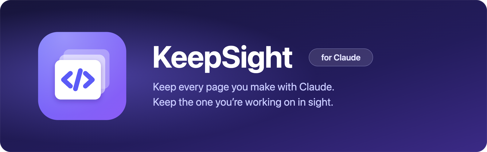
</p>

<p align="center">
  <b>English</b> · <a href="README.ko.md">한국어</a>
</p>

<p align="center">
  <a href="https://github.com/polyglot-k/keepsight/actions/workflows/ci.yml"></a>
  
  
  
  <a href="LICENSE"></a>
</p>

<p align="center">
  <b>Keep every page you make with Claude. Keep the one you're working on in sight.</b><br>
  A local macOS library for your HTML files and claude.ai Artifacts, with a focus window that floats above everything else.
</p>

<p align="center">
  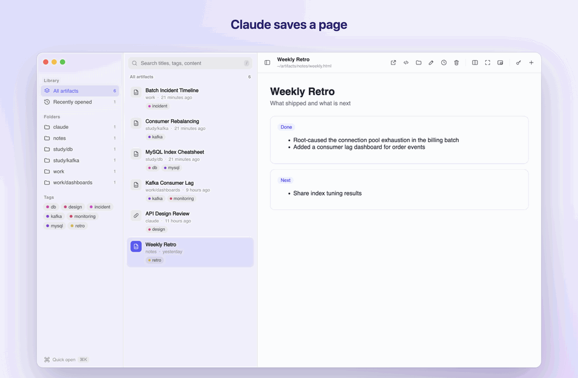
</p>

## What it is

KeepSight is a macOS app for the HTML documents that pile up when you work with Claude: incident timelines, dashboards, study notes, design reviews, and Artifacts published on claude.ai.

- **It keeps them in one folder.** Everything lives in `~/artifacts`. Subfolders are categories. There is no database and no import step.
- **It finds them again.** It searches titles, tags, and full page text, and has a ⌘K palette that works from any app.
- **It keeps them safe.** Every save is versioned automatically, so you can compare any two versions and restore one.
- **It fits into Claude Code.** A hook bookmarks each Artifact you publish, and the skills save HTML files and open the app when you ask in plain words.

## Why it exists

I'm a backend engineer, and over a few months Claude became my default way to explain things. An investigation ended as an HTML timeline. A Kafka question ended as a dashboard. A study session ended as a cheatsheet. They were good documents, and I kept losing them.

Some were Artifacts on claude.ai, buried in old conversations. Others were local files that Claude Code wrote into whatever repo I had open. Finding last month's index cheatsheet meant scrolling chat history or running `find` across my home folder. When Claude rewrote a page, the previous version was gone.

I didn't want a new notes app with its own format. I wanted the files to stay plain HTML in a folder I own, with a fast window on top: a list, a search box, a preview, and history. So I built that, and then made Claude Code feed it automatically.

## Features

<table>
  <tr>
    <td width="50%">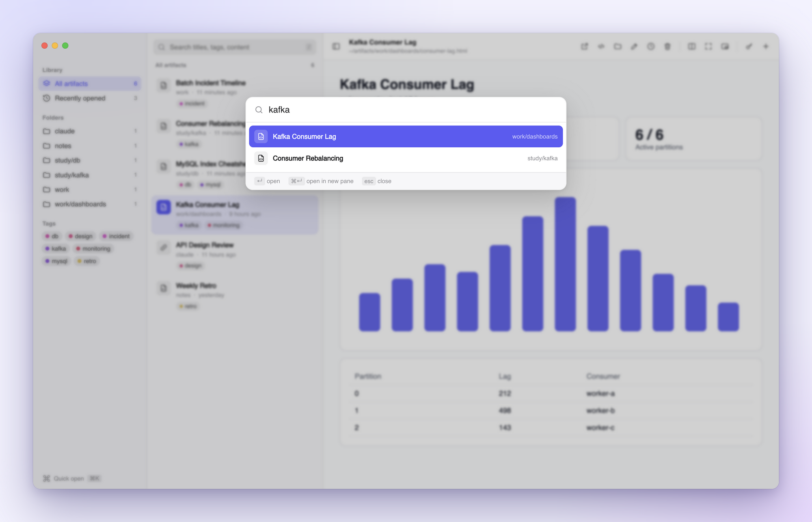</td>
    <td width="50%">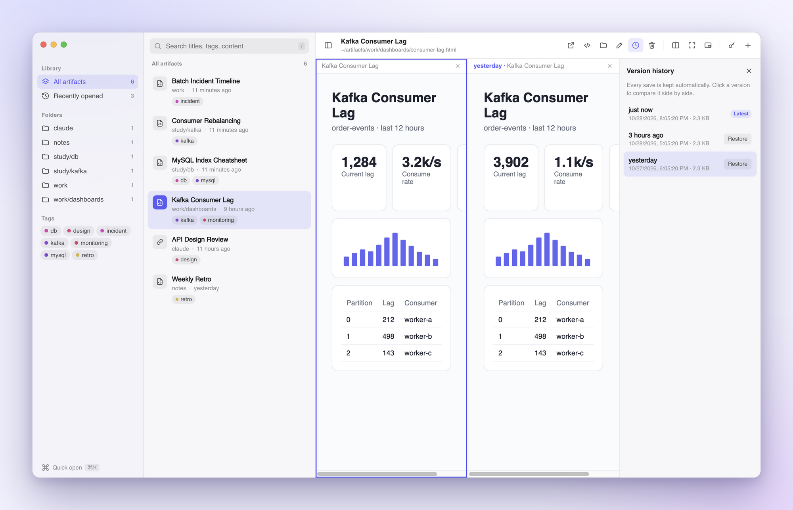</td>
  </tr>
  <tr>
    <td><b>Quick open, from anywhere.</b> Press <kbd>⌘K</kbd> in the app or <kbd>⌥⌘K</kbd> in any other app. It does fuzzy matching on title, folder, and tags, and recently opened items rank first.</td>
    <td><b>Version history.</b> Every change to an HTML file is kept. Click a version to open it next to the current one, and restore it in one click. The content you replace is kept too.</td>
  </tr>
  <tr>
    <td>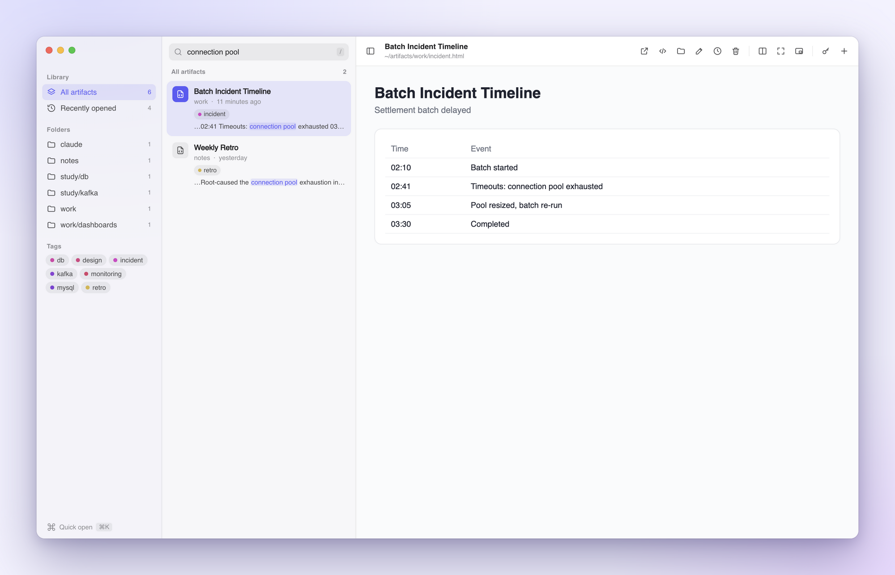</td>
    <td>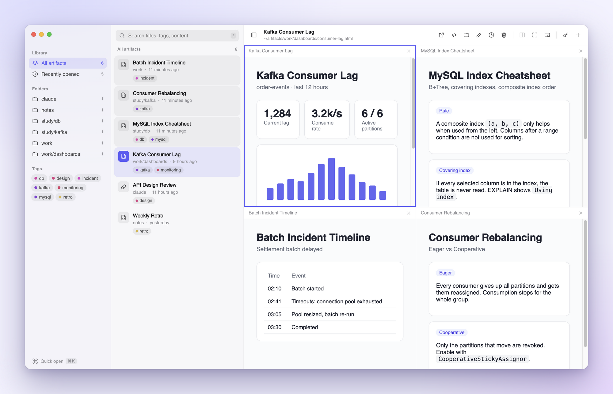</td>
  </tr>
  <tr>
    <td><b>Full-text search.</b> If a query doesn't match a title or tag, the app searches inside the pages and shows the matching line in context.</td>
    <td><b>Split panes.</b> Up to four previews side by side, each with its own zoom. Drag the dividers to resize them.</td>
  </tr>
  <tr>
    <td>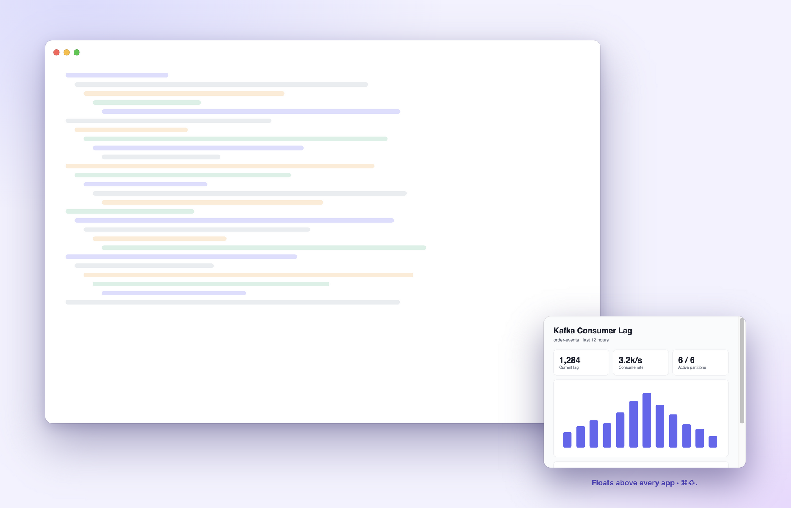</td>
    <td>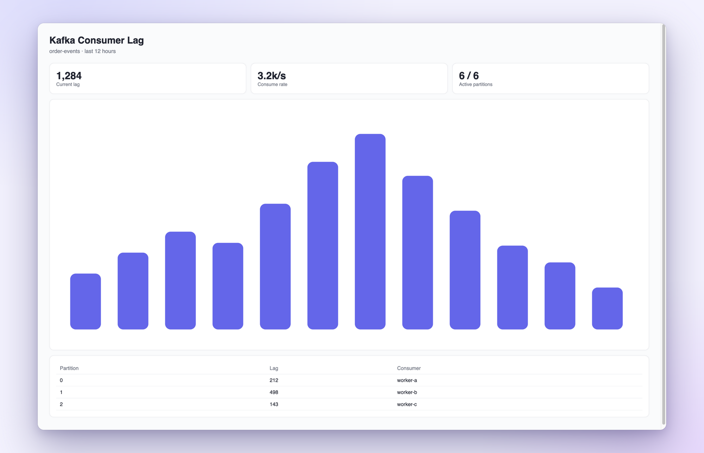</td>
  </tr>
  <tr>
    <td><b>Focus mode: the floating mini window.</b> <kbd>⌘⇧.</kbd> shrinks the window to a small preview that is always on top. It stays visible while you click and type in other apps, so the one page you're working from can't get buried under other windows. If your attention drifts easily (it's ADHD-friendly), this keeps the task in sight. Links can auto-refresh every 1 to 30 minutes.</td>
    <td><b>Zen mode.</b> <kbd>⌘.</kbd> hides everything except the page and fills the screen. Use it for reading and presenting.</td>
  </tr>
  <tr>
    <td>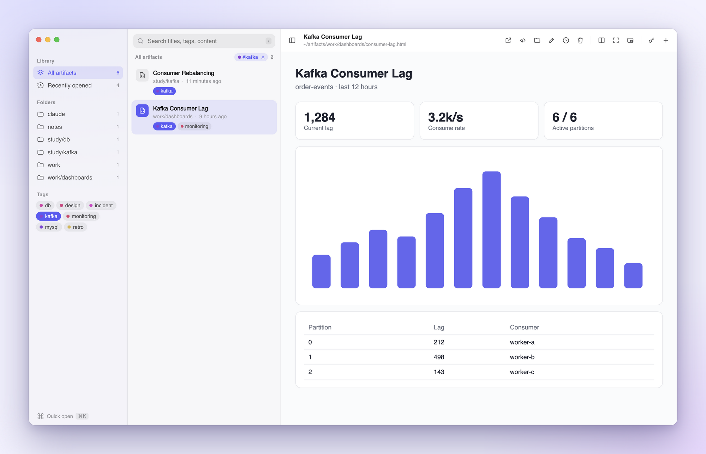</td>
    <td>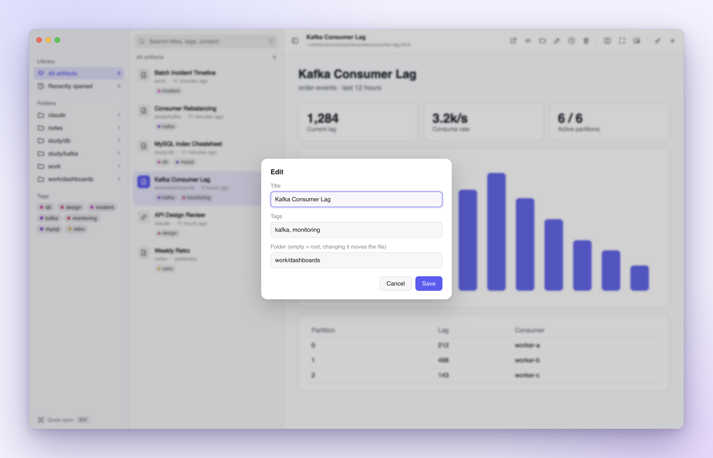</td>
  </tr>
  <tr>
    <td><b>Filter by tag.</b> Click a tag in the sidebar or on any row to show only matching items. The active filter sits above the list. Press <kbd>×</kbd> or <kbd>esc</kbd> to clear it.</td>
    <td><b>Edit in place.</b> Change the title, tags, or folder, and the app writes them back into the file itself. Changing the folder moves the file.</td>
  </tr>
  <tr>
    <td colspan="2">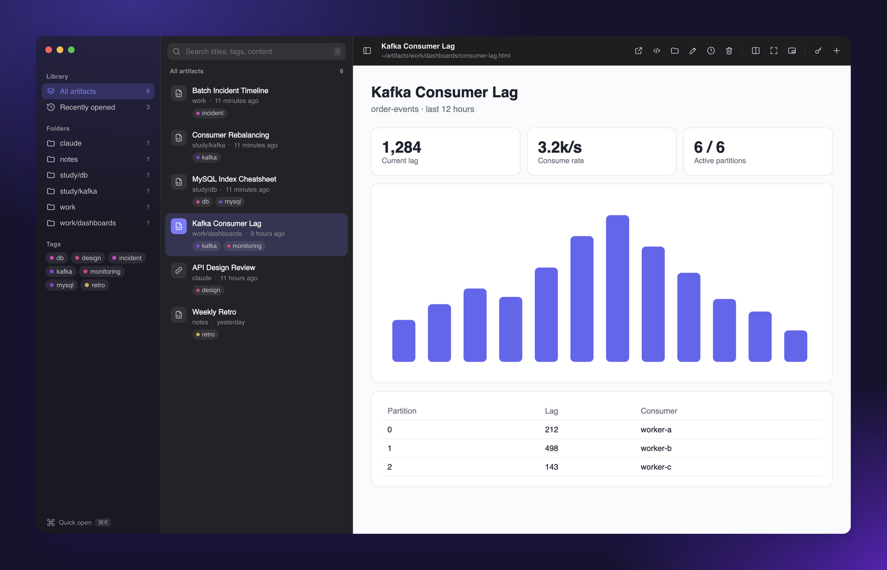</td>
  </tr>
  <tr>
    <td colspan="2"><b>Light and dark.</b> The app follows the system appearance, with a translucent sidebar and a native title bar.</td>
  </tr>
</table>

Also included:
- **Recently opened.** A list of the last 20 items you opened, in order.
- **Live reload.** When Claude Code rewrites a file, the open preview updates.
- **claude.ai sign-in.** The app can reuse your Chrome login, so private Artifacts render inside it.
- **Menu bar.** Closing the window keeps the app in the menu bar, and it can start at login.

## Get started

**Requirements:** macOS and Node.js 20 or later. Claude Code and Chrome are optional.

### Option A: Claude Code plugin (recommended)

```text
/plugin marketplace add polyglot-k/keepsight
/plugin install keepsight@keepsight
```

Then ask Claude: **"set up keepsight"**. This installs the app, registers it to start at login, and opens it. The plugin also registers the publish hook, so there is nothing to configure.

### Option B: From source

```sh
git clone https://github.com/polyglot-k/keepsight.git
cd keepsight
./manage.sh setup
```

`setup` does the following, and running it again is safe:

1. Installs dependencies and runs the tests.
2. Adds a `keepsight` command to `~/.local/bin`.
3. Copies the skills into `~/.claude`.
4. Registers the app to start at login.
5. Launches the app.

Afterwards, `keepsight open` brings the window up from any terminal.

### Option C: Download the app

Grab the `.dmg` from [Releases](https://github.com/polyglot-k/keepsight/releases) and drag the app to Applications. The build is unsigned, so the first time you open it, right-click the app and choose **Open**.

## Claude Code integration

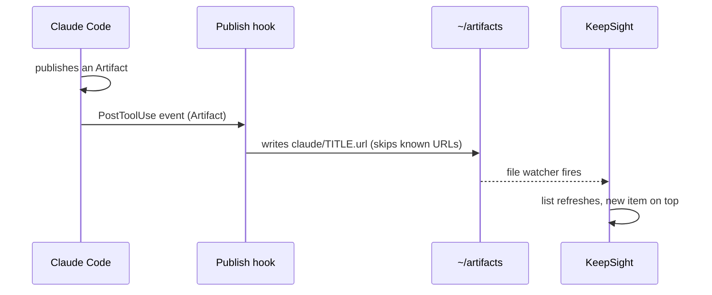

*Publishing an Artifact is enough to make it show up in the app, with no copy-pasting.*

| Piece | What it does | Try saying |
|---|---|---|
| `keepsight-save` skill | Saves an HTML file into `~/artifacts` with a title and tags, or bookmarks a claude.ai link | "save this to keepsight", "add this link to keepsight" |
| `keepsight` skill | Opens, installs, or updates the app | "open keepsight", "update keepsight" |
| Publish hook | Bookmarks every Artifact you publish | *(automatic)* |

If you installed from source rather than as a plugin, register the hook once in `~/.claude/settings.json`:

```json
{
  "hooks": {
    "PostToolUse": [
      { "matcher": "Artifact", "hooks": [{ "type": "command", "command": "node ~/.claude/hooks/artifact-publish.js", "timeout": 10 }] }
    ]
  }
}
```

If you also want Claude to save local HTML pages automatically, add this line to your `~/.claude/CLAUDE.md`:

```md
- When you create a standalone HTML page, save it with the keepsight-save skill.
```

## Design

### Principles

- **The folder is the database.** Categories are subfolders. Tags live inside the file (`<meta name="tags">` for HTML, `Tags=` for `.url` bookmarks). You can move, rename, or edit files in Finder or your editor, and the app reflects the change immediately. Uninstalling loses nothing.
- **Plain files, no lock-in.** An Artifact bookmark is a standard `.url` file that Finder can open. Versions are ordinary HTML files in a hidden folder.
- **Local and private.** Nothing leaves your machine except the pages you choose to open. There is no account, telemetry, or sync service.
- **Claude-native.** The fastest way to add something is to keep working: Claude Code's hook and skills write into the folder for you.
- **Keyboard-first, chrome-light.** Every action has a shortcut. Zen mode and the mini window strip the UI away completely, because the page is the point.
- **Small enough to read in an afternoon.** Electron is the only dependency. There is no frontend framework and no build step, and every function has JSDoc.

### Architecture

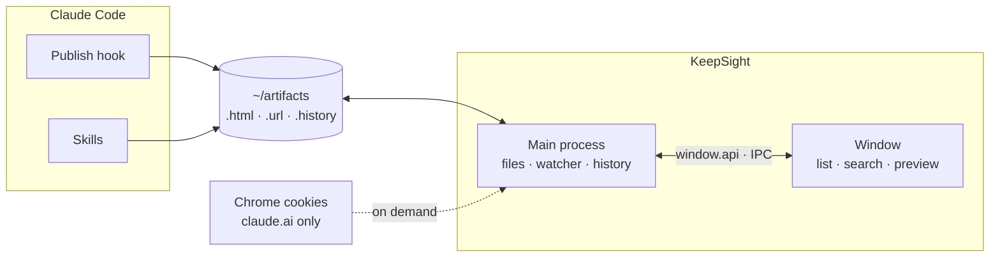

*Only the main process touches the disk. The window asks for everything through a small IPC API.*

- **Trust boundary.** The window has no Node access. Every path it sends is resolved and checked against the root folder before the main process reads, moves, or trashes anything.
- **Previews are sandboxed.** Each pane is a `<webview>` with its own session. Popups are allowed only for sign-in domains, and every other link opens in your browser.
- **Chrome sign-in stays in the main process.** The app decrypts only claude.ai cookies, with a Keychain prompt, and copies them into the preview session. Cookie values never reach the window.
- **Version history** lives in `~/artifacts/.history/<path>/<timestamp>.html`. A version is written only when the content actually changes. Each file keeps its latest 50 versions, and its history follows it when you move it. Restoring first saves the current content, so a restore can itself be undone.
- **No index to corrupt.** The app rescans the folder when it changes. This is plenty for hundreds of files. A cache is the planned upgrade if libraries grow into the thousands.

### Interface

The window has three columns: **Library → List → Preview**. You narrow down from left to right, and the page always gets the most space.

- **Native first.** It uses a hidden-inset title bar, a translucent sidebar, and the system font, with all colors defined as tokens for light and dark. It should feel like it shipped with macOS.
- **One accent.** The indigo-to-violet of the app icon is the only accent color. It marks the current selection, the active pane, and search matches. Tags get stable, hash-derived colored dots, so a tag looks the same everywhere.
- **Quiet chrome.** The toolbar uses icons with tooltips, and pane headers appear only when they have something to say: split mode, zoom, a version label, or a refresh interval.
- **Information density from Finder, not from dashboards.** Each list row has an icon, a title, a folder, a relative time, and tag dots. A search snippet appears only when it matters.

**Non-goals:** it is not an HTML editor (your editor is better), not a sync service (put `~/artifacts` in iCloud or git if you want that), and not cross-platform yet.

## Keyboard shortcuts

| Keys | Action |
|---|---|
| <kbd>⌘K</kbd> · <kbd>⌥⌘K</kbd> | Quick open (in app · from anywhere) |
| <kbd>/</kbd> · <kbd>↑</kbd> <kbd>↓</kbd> · <kbd>↵</kbd> | Search · move · open in browser |
| <kbd>⌘\\</kbd> · <kbd>⌘1</kbd>–<kbd>⌘4</kbd> | Split pane · focus pane |
| <kbd>⌘Y</kbd> | Version history |
| <kbd>⌘.</kbd> · <kbd>⌘⇧.</kbd> | Zen mode · floating mini window (from anywhere) |
| <kbd>⌘E</kbd> · <kbd>⌘⌫</kbd> | Edit · move to Trash |
| <kbd>esc</kbd> | Clear the tag filter |
| <kbd>⌘B</kbd> · <kbd>⌘+</kbd> <kbd>⌘-</kbd> <kbd>⌘0</kbd> | Toggle sidebar · zoom the active pane |

## FAQ

**Can I use a different folder?** Yes. Run `ARTIFACTS_ROOT=/path/to/folder npm start`.

**How do I sync between machines?** Put `~/artifacts` in iCloud Drive, Dropbox, or a git repo. Everything in it is plain files.

**Where is my data?** The documents are in `~/artifacts` and their history is in `~/artifacts/.history`. Window layout, recent items, and refresh intervals are kept in the app's local storage.

**Do I need Claude to use it?** No. Any HTML file you drop into the folder shows up in the app.

**Does the mini window stay on top of everything?** It stays above every normal app window on the current desktop, even while another app has focus. It does not follow you to another Space (desktop), and it does not appear over apps running in macOS full-screen mode.

## Contributing

Issues and PRs are welcome. See [CONTRIBUTING.md](CONTRIBUTING.md) for setup, code style, and the PR checklist, and [CHANGELOG.md](CHANGELOG.md) for what changed.

| Where | What to look at |
|---|---|
| `app/store.js` | Scanning, tags, bookmarks, version history (pure functions, tested in `test/`) |
| `app/main.js` | Windows, shortcuts, file watcher, IPC handlers |
| `app/index.html` | The whole interface (no framework) |
| `app/chrome-cookies.js` | claude.ai cookie import from Chrome |
| `skills/`, `hooks/`, `.claude-plugin/` | Claude Code plugin |
| `manage.sh` | `setup` and `open` |

## License

[MIT](LICENSE) © polyglot-k

KeepSight is an independent project and is not affiliated with or endorsed by Anthropic. Claude is a trademark of Anthropic.
